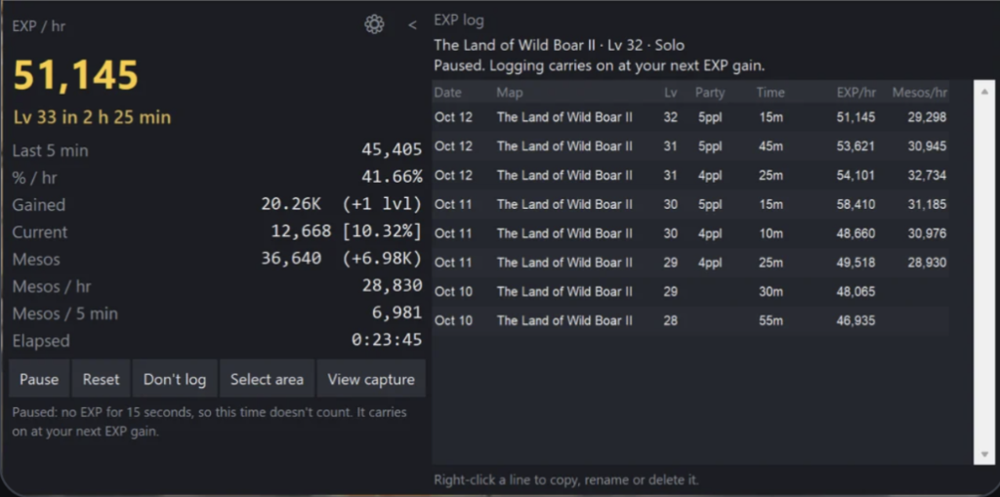

# MapleStory Classic World — EXP & Meso Tracker

A desktop overlay utility for **MapleStory Classic World** that tracks experience rates (`EXP/hr`, `%/hr`), time to next level, Meso farming rates, map locations, and party composition in real time. All completed sessions are persisted locally to `data/exp_log.csv` for external analysis.

The tracker operates strictly via passive screen capture (`mss`) and optical/bitmap character recognition—it does not read process memory, modify game files, or hook into the client.



---

## Installation & Quick Start (Portable Release)

The prebuilt Windows release bundles the Python runtime and required OCR binaries, so no additional setup is needed.

1. Download **`MapleEXPTracker_Portable.zip`** from the [latest release](../../releases/latest).
2. Extract the archive to a local directory.
3. Launch **`MapleEXPTracker.exe`** while MapleStory Classic World is running.
4. Completed sessions are written to **`data/exp_log.csv`** in the same directory.

---

## Overview & Capabilities


- **Deterministic Pixel-Bitmap Recognition (`LV.` & `EXP`)**:
  - Extracts character level from the bottom status bar `LV.` badge and experience values from the `EXP` bar using 7-row pixel-bitmap templates (`LV_BITMAP_TEMPLATES` and `EXP_BITMAP_TEMPLATES`).
  - Automatically detects and normalizes both `1x` windowed layouts (`1920x1080`, `1980x1200`) and `2x` integer-scaled fullscreen/ultrawide layouts (`2560x1440`, `3440x1440`), accounting for horizontal pillarbox offsets.
- **MeowDB Experience Curve & Map Dictionary**:
  - Uses the MapleStory Classic World experience table (Levels 1–100) to cross-validate raw EXP and percentage readings and calculate next-level ETAs.
  - Matches minimap titles against the 423-entry map list (`core/maps.txt`) using Levenshtein distance and Roman numeral normalization, and identifies town maps to pause active timers during restock trips.
- **Automatic Session Splitting**:
  - Transitioning to a new hunting map after at least 60 seconds of active farming automatically commits the previous map's session to `data/exp_log.csv` and resets the session counters.
- **Automatic Inventory Meso & Party Detection**:
  - Locates the Inventory Meso field automatically when the inventory window is visible and suspends Meso updates while Shop, Storage, or Trade windows are open.
  - Detects party size (`Solo` or `2ppl`–`6ppl`) by identifying the vertical column of party HP bar outlines on screen.
- **Idle Auto-Pause & Death Handling**:
  - Pauses active elapsed time after 15 seconds without EXP gain and resumes on the next kill while holding the active rate display.
  - Preserves accumulated session EXP and hourly rates if a character death reduces current EXP on the same level.

---

## Hotkeys

Hotkeys are active while either the **MapleStory** client or the **Tracker** window is in the foreground:

| Shortcut | Action |
| :--- | :--- |
| `Shift + 1` | Pause or resume session timer |
| `Shift + 2` | Save current session to CSV and reset counters |
| `Shift + 3` | Toggle logging (`Don't log`) for the current session |
| `Shift + 4` | Collapse or expand the session log pane |

---

## Development & Building from Source

### Prerequisites
- Python 3.10+
- [Tesseract OCR](https://github.com/UB-Mannheim/tesseract/wiki) installed at `C:\Program Files\Tesseract-OCR`

```powershell
pip install -r requirements.txt
python main.py
```

### Running Tests
```powershell
python -m unittest test_tracker.py test_advanced_tracker.py -v
```

### Building the Portable Executable
```powershell
pip install pyinstaller
python build_exe.py
```
This produces the standalone application in `dist/MapleEXPTracker/` and packages `dist/MapleEXPTracker_Portable.zip`.

---

## Credits
- Reference design and vision heuristics inspired by [beanguri/Maple-Classic-Exp-Overlay](https://github.com/beanguri/Maple-Classic-Exp-Overlay).
- MapleStory Classic World EXP table and map dataset sourced from [MeowDB](https://meowdb.com).
